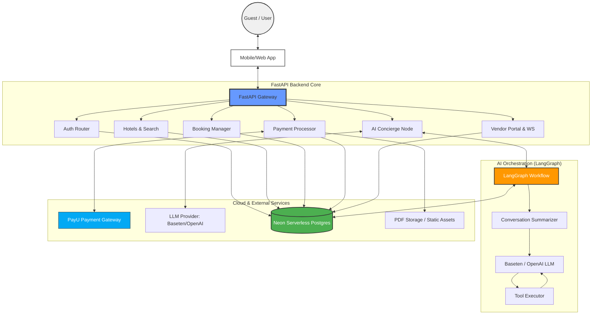

# Arthik Concierge Backend

FastAPI + SQLAlchemy + PayU + Neon Postgres

## High-Level Architecture



## Setup

1. **Install Dependencies**

   ```bash
   pip install -r requirements.txt
   npm install
   ```

2. **Environment Variables**
   Create a `.env` file based on the following template:

   ```env
   DATABASE_URL=postgres://<user>:<pass>@<host>:5432/<db>
   SECRET_KEY=...
   PAYU_MERCHANT_KEY=...
   PAYU_MERCHANT_SALT=...
   PAYU_BASE_URL=https://sandbox.payu.in
   PAYU_SUCCESS_URL=https://<your-domain>/payment/success
   PAYU_FAILURE_URL=https://<your-domain>/payment/fail
   PAYU_WEBHOOK_SECRET=...
   GOOGLE_CLIENT_ID=...
   GOOGLE_CLIENT_SECRET=...
   OPENAI_API_KEY=...
   APP_URL=...
   PDF_TEMP_PATH=./tmp/pdfs
   ```

3. **Database Migrations**

   ```bash
   make migrate
   ```

4. **Seed Data**

   ```bash
   make seed
   ```

5. **Start Server**
   ```bash
   make start
   ```

## Key Features

- **Deterministic Ranking**: Services are ranked using a weighted formula (Price, Rating, Facilities, Location).
- **PayU Sandbox**: Integrated payment flow with hash generation and webhook verification.
- **AI Concierge**: Chat endpoint with intent extraction and automated service search/booking.
- **Real-time Updates**: WebSocket broadcast for vendor service updates.
- **Automated Invoices**: PDF generation upon payment confirmation.

## API Documentation

See [API.md](./API.md) for endpoint details and example curl commands.
